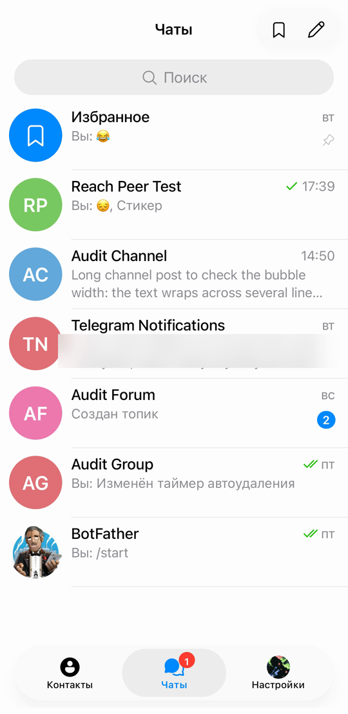
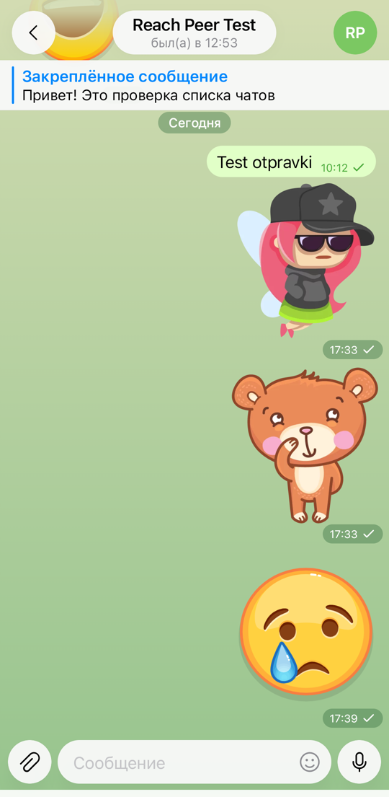
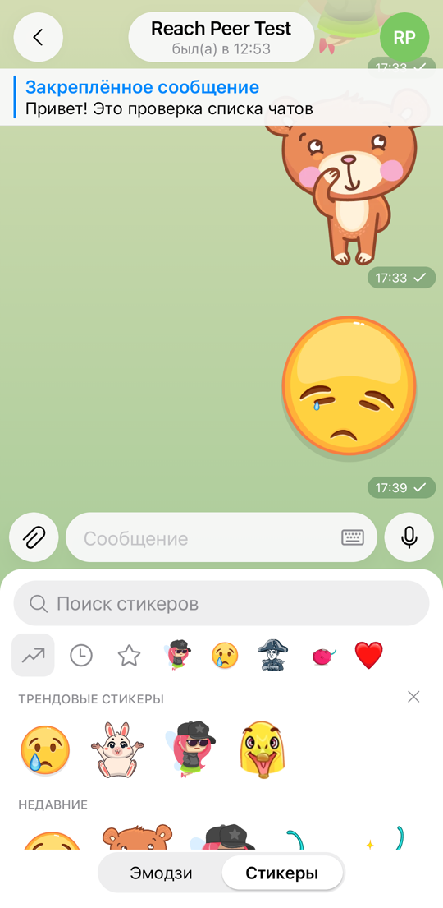
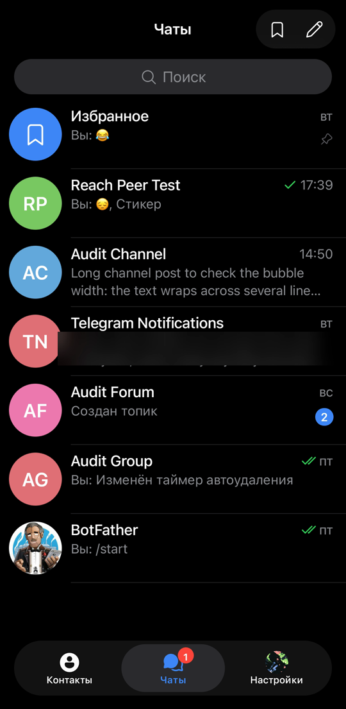
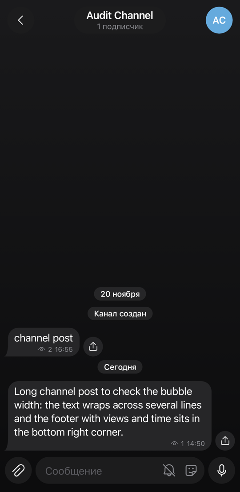
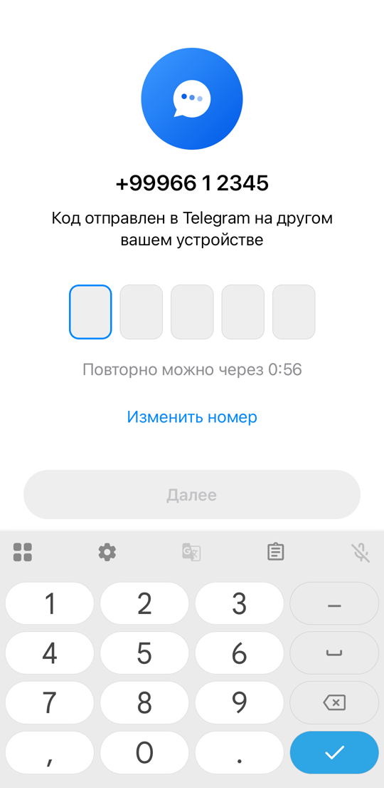
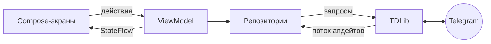

<div align="center">


# Reach

**Клиент Telegram для Android с интерфейсом Telegram iOS**

Jetpack Compose · [TDLib](https://github.com/tdlib/td) · Material 3 под капотом, iOS 26 снаружи

[](https://github.com/iufb/reach/releases/latest)
[](https://github.com/iufb/reach/actions/workflows/android.yml)


[**Скачать APK**](https://github.com/iufb/reach/releases/latest) · [Что умеет](#что-умеет) · [Как устроено](#как-устроено) · [Разработка](#разработка)

</div>

<br>

<table>
  <tr>
    <td align="center"><br><sub>Список чатов</sub></td>
    <td align="center"><br><sub>Чат: стикеры, эмодзи, пузыри</sub></td>
    <td align="center"><br><sub>Панель стикеров с поиском</sub></td>
  </tr>
  <tr>
    <td align="center"><br><sub>Тёмная тема</sub></td>
    <td align="center"><br><sub>Канал: посты-пузыри</sub></td>
    <td align="center"><br><sub>Вход: шаги с анимациями</sub></td>
  </tr>
</table>

## Зачем

Telegram на iPhone и на Android выглядят по-разному. Reach переносит раскладку и визуальный язык **Telegram iOS 26** — плавающие стеклянные панели, «линзу» в таббаре, пузыри, сгруппированные списки — на Android, а поведение оставляет андроидным: системный «назад», клавиатура, уведомления.

Вся работа с протоколом — сеть, шифрование, авторизация, синхронизация, кэш — у официальной библиотеки [TDLib](https://github.com/tdlib/td). Reach строит только интерфейс и состояние.

> [!NOTE]
> Reach — неофициальный клиент, он не связан с Telegram и не выдаёт себя за него: своё название, свой знак, без логотипа и «самолётика» Telegram в брендинге. Работает по [Telegram API Terms of Service](https://core.telegram.org/api/terms).

## Что умеет

**Чаты**
- Список с папками, архивом, закрепом, черновиками, отметкой «непрочитано», без звука, зелёной точкой «в сети»
- Глобальный поиск по чатам, сообщениям и публичным каналам
- Контакты, новый чат, группы, каналы, форумы с темами
- Профили, участники, права администраторов, ссылки-приглашения, статистика каналов

**Сообщения**
- Ответы, пересылка, правка, удаление, закреп, выбор нескольких, реакции с анимацией
- Форматирование текста, ссылки с превью, отложенные и тихие сообщения
- Комментарии к постам каналов, посты пузырями с просмотрами и кнопкой «Поделиться»

**Медиа**
- Фото, видео, альбомы, файлы, аудио с плеером, GIF
- Голосовые и видеокружки — запись как в Telegram iOS: свайп для отмены, фиксация, предпрослушивание
- Камера прямо в меню скрепки: живое превью в сетке, снимок сразу в отправку
- Редактор фото: кадрирование, рисование, текст
- Автозагрузка по типу сети

**Стикеры и эмодзи**
- Анимированные стикеры (TGS, WebM), анимированные эмодзи с эффектами
- Панель «Эмодзи | Стикеры»: недавние, избранные, паки, тренды, поиск по эмодзи, словам и названиям паков
- Свои шрифты: SF Pro и Apple Color Emoji, если положить их на устройство

**Интерфейс**
- Светлая и тёмная темы по палитре Telegram iOS
- Таббар с «линзой» liquid glass: мгновенное переключение вкладок, линзу можно тянуть пальцем
- Скелетоны при загрузке, анимированный вход, плавные переходы между экранами
- Английский и русский, выбор языка в настройках
- Иконки [Fluent UI System Icons](https://github.com/microsoft/fluentui-system-icons)

Полный список функций с версиями — в [PRODUCT.md](PRODUCT.md).

## Установка

1. Скачайте `reach-<версия>.apk` со страницы [Releases](https://github.com/iufb/reach/releases/latest).
2. Разрешите установку из этого источника и установите.
3. Войдите по номеру телефона — код придёт в Telegram на другом устройстве или по SMS.

Нужен Android 12 или новее.

## Как устроено



- **TDLib — единственный источник правды.** Своей базы сообщений нет: репозитории собирают состояние из потока апдейтов TDLib и отдают экранам `StateFlow`.
- **Jetpack Compose** + **Hilt**, Navigation Compose, Coil, Media3, Lottie, [Haze](https://github.com/chrisbanes/haze) для живого размытия под стеклом.
- **TDLib собирается в GitHub Actions** и подключается как готовый архив из GitHub Release — в репозитории нет бинарей.
- Решения записаны в [ADR](docs/adr): от сборки и брендинга до переноса UI Telegram iOS.

## Разработка

APK локально не собирается ([ADR-0001](docs/adr/0001-ci-only-builds.md)) — всё делает GitHub Actions:

| Workflow | Что делает |
|---|---|
| `Android` | debug, `testdc` и `releaseTestdc` APK, тесты и lint на каждый push и PR |
| `TDLib` | собирает TDLib и публикует `tdlib.zip` в Release; версия — `tdlib.release` в `gradle.properties` |
| `Release` | подписанный APK и GitHub Release по тегу `v*` |

Поставить свежую сборку на подключённое устройство:

```sh
scripts/install-apk.sh                # debug-сборка текущей ветки
scripts/install-apk.sh --testdc main  # сборка на тестовых серверах Telegram
```

Нужны авторизованный `gh` и `adb`. Сборка `testdc` («Reach Test») ходит на тестовые серверы Telegram и ставится рядом с основной; собеседника для проверок даёт `scripts/peer.py`.

Секреты репозитория: `APP_ID`, `APP_HASH` (с [my.telegram.org](https://my.telegram.org)), ключ подписи релиза и Firebase для уведомлений — см. [ADR-0014](docs/adr/0014-release-build.md).

<div align="center">
<br>
<sub>Знак Reach — R «Вершина»: путь к вершине, «reach» — достичь. Исходники в <a href="docs/brand">docs/brand</a>.</sub>
</div>
